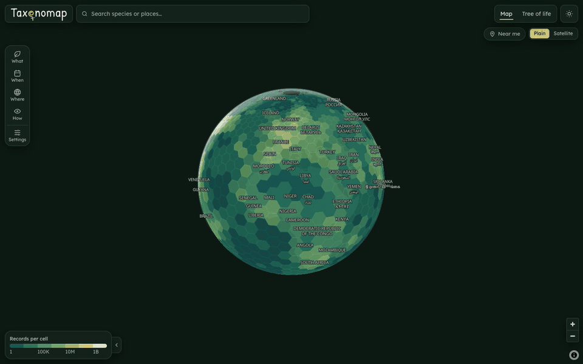

<picture>
  <source media="(prefers-color-scheme: dark)" srcset="docs/brand/readme-banner-dark.svg">
  
</picture>

# Taxonomap


A map for exploring species records from [GBIF](https://www.gbif.org), with species pages, a tree of life and a "near me" mode. Live at [app.taxonomap.com](https://app.taxonomap.com).



- See where records are on the map, and filter by species, date, place, record type or licence
- Click a hexagon to list the species recorded there, down to individual records
- Open a species page for photos, seasonality and yearly charts, Red List status and similar species
- Browse the tree of life from kingdoms down to species, as a sunburst or icicle chart
- Drop a pin or use your location to see local species and recent sightings

It's a static site. Astro pre-renders the pages, Vue islands handle the interactive parts and the browser calls GBIF directly, so there's no application server.

## Running it

You need Node 24 and pnpm. Set `GBIF_CONTACT_EMAIL` in `.env`; the other settings are explained in `.env.example`.

```bash
cp .env.example .env
pnpm install
pnpm dev
```

## Scripts

- `pnpm build`, `pnpm preview`: build to `dist/` and serve it
- `pnpm lint`, `pnpm format`, `pnpm check`: ESLint, Prettier, type checks
- `pnpm test`, `pnpm test:coverage`: unit tests, with or without coverage (every `.ts` file held at 100%)
- `pnpm build:e2e`, `pnpm test:e2e`: Playwright against a fake GBIF, no network needed (run `pnpm exec playwright install chromium` once)
- `pnpm test:e2e:coverage`: the same journeys, measuring how much of each component (`.vue`, `.astro`) they run, held to the floors in `tests/e2e/coverage.ts` (`E2E_COVERAGE=report pnpm exec playwright test <spec>` reports on some journeys without them)
- `pnpm test:contract`: checks the live GBIF API still behaves as the client expects
- `pnpm bake`: fetch the data the build needs (GBIF, iNaturalist and Wikipedia) and save it to `.cache/baked/`. The build makes no external requests: without a bake it has no species pages or `/data` snapshots, and the browser fetches that data live
- `pnpm ioc-names <VernacularName.tsv>`: rebuild the IOC bird names from GBIF's backbone archive

## Data

Occurrence data comes from GBIF.org and its publishers. Records and images in the app credit their dataset or publisher and licence.

## Licence

The code is licensed under the GNU General Public License v3.0; see [LICENSE](LICENSE). Occurrence data and images keep their own licences, as above.
