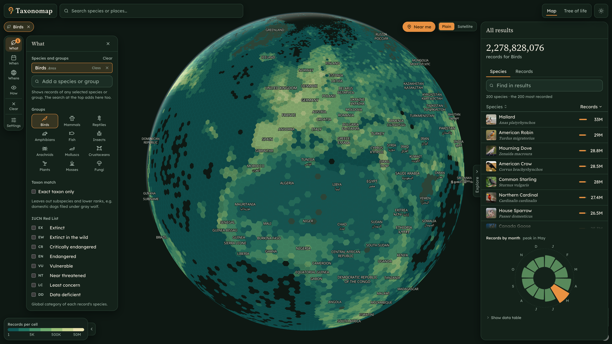

<picture>
  
</picture>


Live site found here https://app.taxonomap.com

An interactive map that visualises all of the biodiversity data stored in [GBIF’s](https://www.gbif.org) databases. You can explore the globe and click on any hex which will show you all the species that have been recorded in that area. You can sort by time, taxon, record type, and more.



- See where records are on the map, and filter by species, date, place, record type and other fields
- Click a hexagon to list the species recorded there and the induvidual records
- Open a species page for photos, a description from Wikipedia, charts and other details
- Browse the tree of life from kingdoms down to species, as a sunburst or icicle chart
- See what's near you, by dropping a pin or providing your location

It's a static site. Astro pre-renders the pages, Vue islands handle the interactive parts and the browser calls GBIF directly, so there's no application server.

## Running it

You need Node 24 and pnpm. Set `GBIF_CONTACT_EMAIL` in `.env`; the other settings are explained in `.env.example`.

```bash
cp .env.example .env
pnpm install
pnpm dev
```

## Data

Occurrence data comes from GBIF.org and its publishers. Records and images in the app credit their dataset or publisher and licence.

## Licence

The code is licensed under the GNU General Public License v3.0; see [LICENSE](LICENSE). Occurrence data and images keep their own licences, as above.
