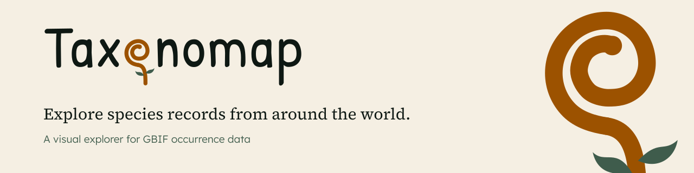

<picture>
  <source media="(prefers-color-scheme: dark)" srcset="docs/brand/readme-banner-dark.svg">
  
</picture>

# Taxonomap

A static, visual explorer for [GBIF](https://www.gbif.org) occurrence data, built for birders, naturalists, recorders and educators. Pages are pre-rendered at build time, interactive parts hydrate as Vue islands, and the browser calls `api.gbif.org` directly. There is no application server.

Live at [app.taxonomap.com](https://app.taxonomap.com).

**Stack:** Astro 7 (static) · Vue 3 islands · Nano Stores · MapLibre GL · D3 / Observable Plot · Tailwind CSS 4 · Workbox · Vitest / Playwright · Cloudflare Pages.

## Quick start

Needs Node 24 (`.nvmrc` pins it) and pnpm.

```bash
cp .env.example .env    # set GBIF_CONTACT_EMAIL at least
pnpm install
pnpm dev                # http://localhost:4321
```

## Docs

| Doc                                            | What's in it                                                          |
| ---------------------------------------------- | --------------------------------------------------------------------- |
| [Development](docs/development.md)             | Setup, scripts, environment variables, performance budget and testing |
| [Features](docs/features.md)                   | Map explorer, species pages, tree of life, What's near me             |
| [Architecture](docs/architecture.md)           | Code layout, URL state and how the islands talk                       |
| [Caching strategy](docs/caching.md)            | Memory, service worker, build disk cache and CDN                      |
| [GBIF API findings](docs/gbif-api-findings.md) | Where the live API differs from the docs                              |
| [Deployment](docs/deployment.md)               | CI, Cloudflare Pages, secrets and variables                           |
| [Design system](docs/design-system.md)         | Colour, type, logo and components                                     |

## Data and attribution

Occurrence data comes from GBIF.org and its publishers. Every record and image shown in the app credits its dataset or publisher and its licence.
